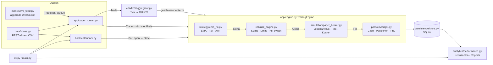

# Architektur

Ein einziger, synchroner und deterministischer Kern, den Backtest und Paper-Modus identisch nutzen.
Nebenläufigkeit gibt es nur am Rand (WebSocket-Thread → begrenzte Queue → ein Konsument).

## Module

| Modul | Verantwortung |
|---|---|
| `core/config.py` | Laden, Zusammenführen, Typprüfung und Validierung der Konfiguration; `PAPER_ONLY`; Config-Hash. |
| `core/domain.py` | Typisierte Modelle: `Candle`, `Signal`, `Order`, `Fill`, `Trade`, `EquitySnapshot`, `RiskDecision`, Enums. |
| `candles/aggregator.py` | Tick → OHLCV, Schließen nur nach Intervallende, Lücken-/Out-of-order-Erkennung, Resampling, Kerzenvalidierung. |
| `indicators/ema.py`, `rsi.py`, `atr.py` | Inkrementelle Indikatoren (SMA-Seed, Wilder-Glättung), Warmup, Ablehnung nicht-endlicher Werte. |
| `strategy/ema_rsi.py` | `generate_signals(candle, context)`; Kreuzungs- oder Zustandsmodus, ATR-Stop, Cooldown. Eine Instanz pro Symbol. |
| `risk/risk_engine.py` | Stop-basiertes Sizing, Exposure-/Positions-/Funds-Caps, Mindestmengen, Tagesverlust, Drawdown-Kill-Switch. |
| `simulation/paper_broker.py` | Validierung, `NEW→ACCEPTED→PARTIALLY_FILLED→FILLED/CANCELED/REJECTED`, Market + Stop-Market, Spread/Slippage, Volumenbeteiligung, Funds-Prüfung. Bucht Fills sofort ins Ledger. |
| `portfolio/ledger.py` | Cash-Buchhaltung, Netto-Position je Symbol, Durchschnittspreis, Open/Increase/Reduce/Close/Reverse, Fill-ID-Idempotenz, Invarianten. |
| `persistence/store.py` | SQLite-Schema (Migrationen), Transaktionen, Laufmetadaten + Config-Hash, Rekonstruktion per Fill-Replay. |
| `app/engine.py` | Verdrahtung, Signal-Routing, Schutz-Stops, Kill-Switch-Reaktion, Datenqualitätsereignisse, Resume. |
| `app/paper_runner.py` | Warmup, Feed-Thread, Queue/Backpressure, Backfill der ersten Live-Kerze, Health, Graceful Shutdown. |
| `backtest/runner.py` | Zeitlich gemergte Bars aller Symbole, Datenqualität, Buy-and-Hold-Vergleich. |
| `analytics/performance.py` | Round-Trip-Gruppierung, Kennzahlen mit Definitionen, Markdown/CSV/JSON-Reports. |
| `market/live_feed.py` | Kombinierter Stream, Parsing, Backoff mit Jitter, Sequenzlücken, Stop. |
| `utils/log_setup.py` | JSON-Logs mit UTC-Zeit, Kontextfeldern (`run_id`, `symbol`, `order_id`), Rotation, Redaktion. |

## Zentrale Regeln

**Zeit:** Alle Zeitstempel sind Millisekunden seit Epoch (UTC). Eine Kerze deckt `[open_time, close_time)` ab.
Signalzeitpunkt ist `close_time` der Signal-Kerze, nie die Wanduhr.

**Kein Lookahead:** Orders werden ausschließlich in `market_step` gematcht, und zwar mit Marktdaten *nach* ihrer
Erzeugung. Im Backtest heißt das Open des Folge-Bars, im Paper-Modus der nächste Trade. Stops lösen intrabar aus
(low ≤ Stop bzw. high ≥ Stop). Bei einem Gap wird zum schlechteren Open gefüllt. Ein Stop, der direkt nach dem
Entry-Fill entsteht, wird noch im selben Bar geprüft (konservativ).

**Positionsrichtlinie:** Eine Netto-Position je Symbol. Entry-Signale bei offener Position oder ausstehendem Entry
werden blockiert (`BLOCKED_*`). Exits sind nie durch Risiko oder Cooldown blockiert. Reverse ist nur mit
`risk.allow_reversal` möglich und läuft als Exit-Order plus neue Entry-Order.

**Buchhaltungsinvarianten** (getestet, `Ledger.check_invariants`):
- `equity = cash + Σ qty × mark`
- `equity = start_cash + realized_pnl + unrealized_pnl − fees_paid` (Toleranz 1e-12 wegen der Durchschnittspreis-Division)
- Jede `fill_id` wird genau einmal gebucht (Ledger-Set und SQLite-Primärschlüssel).
- Gebühren werden genau einmal beim Fill gebucht; Trades tragen anteilige Entry- und Exit-Gebühren.

**Rundung:** Rechnung in `Decimal` ohne Zwischenrundung. Fill-Preise werden auf `tick_size` gegen den Trader
gerundet, Mengen auf `step_size` abgerundet, Gebühren auf 1e-10 aufgerundet.

**Persistenz und Wiederherstellung:** Fills sind die Quelle der Wahrheit. `rebuild_ledger` spielt sie in
`seq`-Reihenfolge erneut ein. Kill-Switch-Zustand, Stop-Preise und Zähler liegen in der Tabelle `state`. Beim Resume
werden offene Orders storniert (`CANCELED_ON_RESTART`), Schutz-Stops neu gesetzt und die Indikatoren per Warmup
aufgebaut. Ein Resume mit anderem Config-Hash wird abgelehnt.

**Threads (Paper):** `feed` schreibt nur in die Queue. Der Hauptthread ist der einzige, der Engine, Ledger und
Store anfasst. Shutdown: Stop-Event → Feed schließen → `join(10 s)` → Queue höchstens 5 s abarbeiten →
finaler Snapshot.

## SQLite-Schema (v2)

`runs` (Modus, Profil, Status, Config-Hash und -JSON, Metadaten), `orders`, `fills` (PK `fill_id`, `seq`),
`trades` (Journal je Schluss-Fill, `position_id` für Round-Trips), `signals` (inkl. Ergebnis wie `ORDER_ACCEPTED`
oder `RISK_REJECTED:<Grund>`), `equity`, `events` (`DATA_GAP`, `RISK_REJECT`, `KILL_SWITCH`, `RECOVERY`, ...), `state`.

## Legacy-Module

Die folgenden Module gehören zu den beiden früheren Pipelines (siehe [AUDIT.md](AUDIT.md)). Sie werden von
`main.py`/`cli.py` **nicht mehr importiert**, sind vom Linting ausgenommen und sollen nach Freigabe entfernt werden
(siehe [ROADMAP.md](ROADMAP.md)):

`analytics/{analytics_engine,equity_curve,equity_logger,health_monitor,metrics,performance_analyzer,replay_engine,snapshot_manager,statistics,trade_logger,watchdog}.py`,
`candles/{candle_engine,candle_store,timeframes}.py`, `config/settings.py`, `core/{events,models,state}.py`, `core/eventing/`,
`data/historical_loader.py`, `indicators/{cache,indicator_engine}.py`, `market/{heartbeat,market_state,market_stream,reconnect-manager,tick_buffer,websocket_client}.py`,
`portfolio/{account_state,exposure,pnl,portfolio,portfolio_manager,risk_manager,valuation_engine}.py`, `portfolio/handlers/`, `portfolio/models/`,
`risk/{position_sizer,risk_manager}.py`, `risk/filters/`, `simulation/*` außer `paper_broker.py`,
`strategy/*` außer `ema_rsi.py`, `utils/*` außer `log_setup.py`, `trade_ledger.py`, `test_bus.py`, `test_replay.py`.

Ausnahme: `indicators/ema.py` und `indicators/rsi.py` sind die neuen Implementierungen. Sie behalten die alten
Funktionsnamen `calculate_ema`/`calculate_rsi`, damit die Legacy-Module importierbar bleiben.
